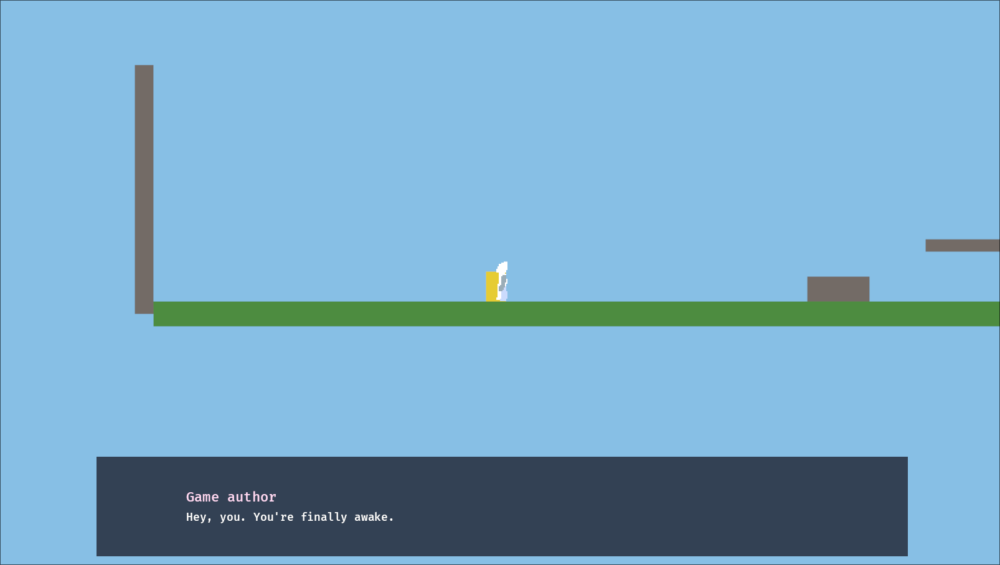

# The game
Not that game, this game. 

It is writen in bevy game engine!

The name of the game is still a subject to be decided, but it will be about.. climbing a mountain! There's no mountain though...

Basic stuff like movement, interactions, dialogues, cutscenes are done. There's no lore or anything, *yet* :)

Many things is yet to be done. Im planning to work more on assets, add some kind of tile-map worlds and maybe lighting, particles and sound.

Thats actually a lot of stuff.

# Building
## System dependencies: 
- Latest stable rust version would be nice for bevy(rustc 1.100.0 at the time of making this)
- Other libraries shown below
```bash
sudo pacman -S base-devel pkgconf alsa-lib libx11 libxcursor libxrandr libxi wayland libxkbcommon vulkan-icd-loader ## Package names may differ depending on your distribution

nix develop # Or you can just run this in the game root, if you're using nix

git clone https://github.com/FishyNavi/the-game.git
cd the-game
cargo build
```
